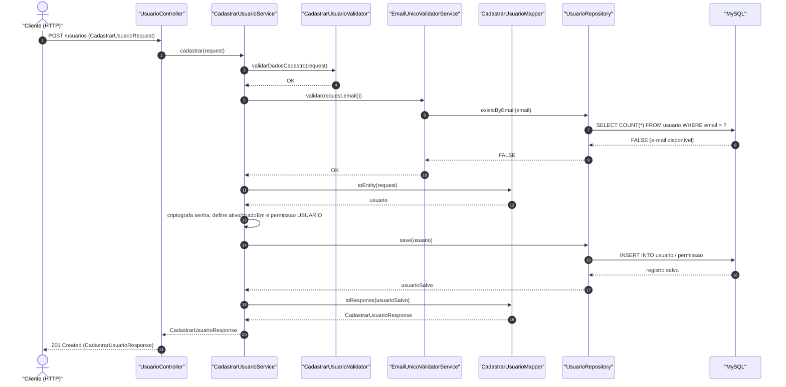
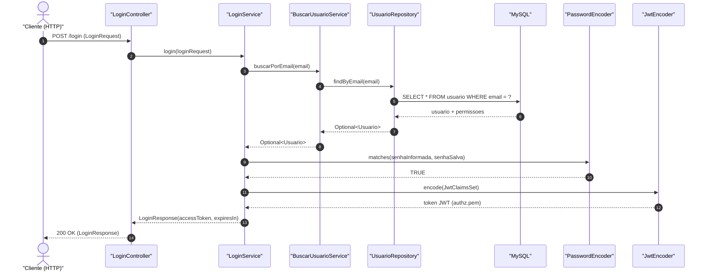

# Diagramas de Sequência — Cadastro e Autenticação

Este documento descreve o fluxo de cadastro de usuário e o fluxo de autenticação na API do GeekHub.

## Regras de escrita aplicada (ASD-STE100 adaptado ao PT-BR)

- Cada etapa descreve uma única ação.
- As frases usam voz ativa e termos técnicos consistentes com o código-fonte.
- Os participantes correspondem exatamente às classes e tabelas da camada atual da aplicação.

---

## 1. Fluxo de Cadastro de Usuário (`POST /usuarios`)

1. O cliente envia `POST /usuarios` com `CadastrarUsuarioRequest`.
2. O `UsuarioController` chama `CadastrarUsuarioService.cadastrar(request)`.
3. O `CadastrarUsuarioService` valida os dados de entrada com `CadastrarUsuarioValidator.validarDadosCadastro(request)`.
4. O `CadastrarUsuarioService` verifica a unicidade do e-mail com `EmailUnicoValidatorService.validar(email)` via `UsuarioRepository.existsByEmail(email)`.
5. O `CadastrarUsuarioMapper.toEntity(request)` cria a entidade `Usuario`.
6. O `CadastrarUsuarioService` criptografa a senha, define `ativo = TRUE`, define `criadoEm` e adiciona a permissão `USUARIO`.
7. O `UsuarioRepository.save(usuario)` persiste o usuário e sua permissão no banco `MySQL`.
8. O `CadastrarUsuarioMapper.toResponse(usuario)` cria `CadastrarUsuarioResponse`.
9. O `UsuarioController` retorna `201 Created` com `CadastrarUsuarioResponse`.

*Exceções tratadas pelo `GlobalExceptionHandler`: dados inválidos (`400 Bad Request`) e e-mail já cadastrado (`409 Conflict` via `ConflitoException`).*

---

## 2. Fluxo de Autenticação / Login (`POST /login`)

1. O cliente envia `POST /login` com `LoginRequest` (`email` e `senha`).
2. O `LoginController` chama `LoginService.login(loginRequest)`.
3. O `LoginService` busca o usuário pelo e-mail com `BuscarUsuarioService.buscarPorEmail(email)` via `UsuarioRepository.findByEmail(email)`.
4. O `LoginService` valida a senha com `PasswordEncoder.matches(senhaInformada, senhaSalva)`.
5. O `LoginService` gera o token JWT com `JwtEncoder.encode(...)` contendo `email`, `scope` (permissões) e expiração de 3600 segundos.
6. O `LoginService` retorna `LoginResponse` com `accessToken` e `expiresIn`.
7. O `LoginController` retorna `200 OK` com `LoginResponse`.

*Exceções tratadas pelo `GlobalExceptionHandler`: dados inválidos (`400 Bad Request`) e usuário ou senha incorretos (`401 Unauthorized` via `BadCredentialsException`).*

